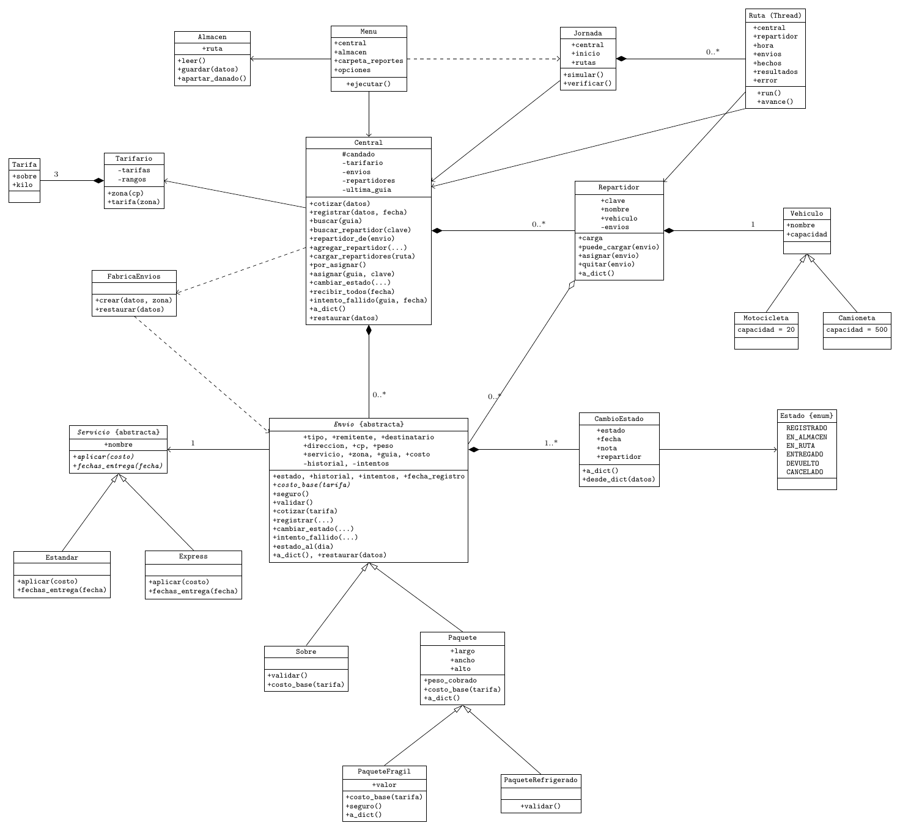
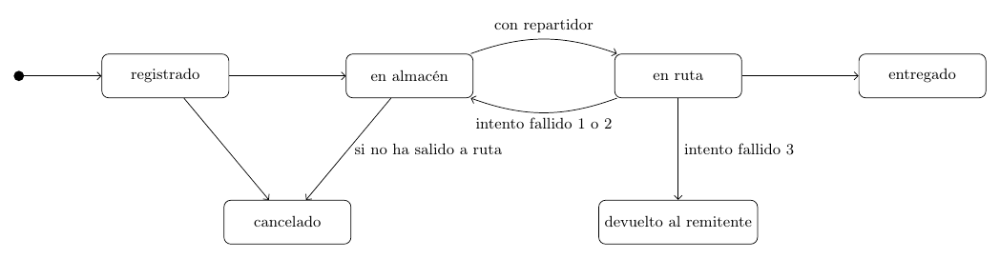
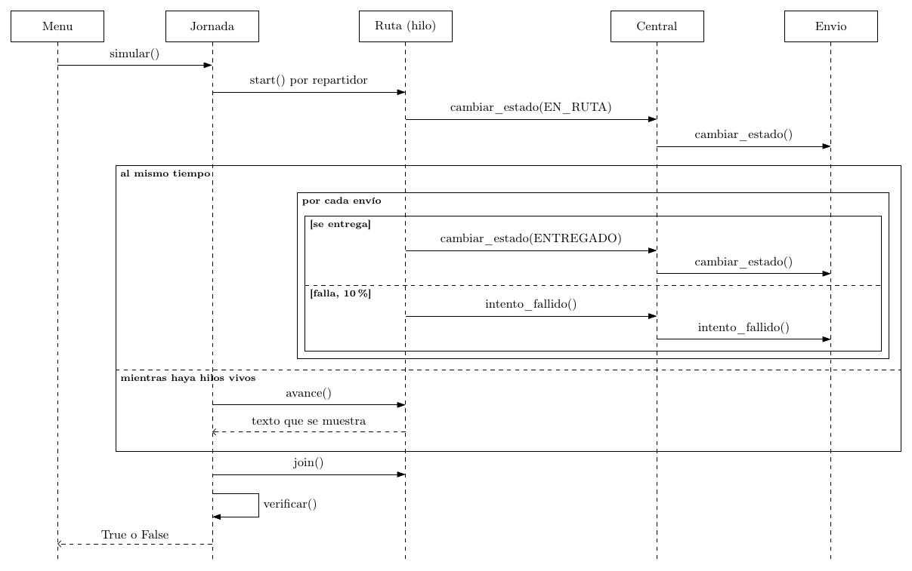

# Documento de diseño

## 1. Diagramas UML

### Diagrama de clases

Muestra las clases, sus atributos, sus métodos y cómo se relacionan. Se eligió porque es donde se ve qué hace cada
parte del sistema.

### Diagrama de estados

Muestra por qué estados pasa un envío. Se eligió porque la mayoría de los rechazos dependen del estado.

### Diagrama de secuencia

Muestra la jornada de reparto: un hilo por repartidor y la revisión final. Se eligió porque es la parte donde
varias cosas pasan al mismo tiempo.

## 2. Decisiones de diseño

| Concepto | Dónde se usa | Qué problema resuelve |
|---|---|---|
| Encapsulamiento | Historial e intentos de `Envio`, envíos de `Repartidor` | El estado y la carga solo cambian con métodos que revisan las reglas |
| Herencia y clases abstractas | `Envio` y sus tipos, `Servicio`, `Vehiculo` | Cada tipo solo define lo que lo hace distinto |
| Composición y agregación | `Envio` tiene su historial; `Repartidor` agrupa envíos | El historial no existe sin el envío; el envío sí existe sin repartidor |
| Polimorfismo | `costo_base`, `seguro`, `validar`, `aplicar` | La central cotiza sin preguntar el tipo de envío |
| Excepciones | `excepciones.py` | El menú atrapa un solo error base y muestra el motivo |
| Archivos | `leer_csv`, `Almacen`, `reporte.py` | Cargar tarifas, importar envíos, hacer reportes y conservar los datos; se escribe en un temporal para no dañar lo guardado |
| Hilos | `Ruta` y candado de `Central` | Los repartidores trabajan al mismo tiempo sin dañar los datos |
| Patrones de diseño | `FabricaEnvios` (Factory), `Servicio` (Strategy), `Envio.cotizar` (Template Method), `Central` (Facade) | Crear el tipo correcto, cambiar el precio según el servicio y que el menú use una sola clase |

### Detalles que decidimos

- El 50 % de express se aplica al costo y al 20 % de frágil, pero no al seguro.
- Los días de entrega son naturales.
- Un sobre pesa máximo 1 kg y un paquete 500 kg, que es lo que carga una camioneta.
- La capacidad se revisa con el peso real.
- La zona es la del primer rango de `zonas.csv` que contiene el código postal. El origen es la Ciudad de México.
- Un envío necesita repartidor para salir a ruta. Si la entrega falla, se queda sin repartidor.
- Un envío que ya salió a ruta no se cancela aunque haya regresado al almacén.
- Un cambio no puede tener una fecha anterior al último cambio del envío.
- En la asignación automática van primero los express y después los más antiguos. Cada envío se le da al repartidor
  con menos envíos que todavía lo pueda cargar.
- Los ingresos del reporte son de los envíos registrados ese día, sin los cancelados ese mismo día.
- En la jornada cada intento tiene 10 % de probabilidad de fallar y se hace un intento por envío al día.
- Al importar, si el archivo no tiene las columnas completas no se registra ninguno.
- Se agregó una opción para recibir en el almacén todos los envíos registrados.

## 3. Alternativas

- **Estados con un diccionario o con una clase por estado.** Se eligió el diccionario porque los estados casi no
  tienen comportamiento propio y así las reglas se leen en un solo lugar.
- **JSON o CSV para guardar.** Se eligió JSON porque el historial es una lista dentro de cada envío y en CSV
  harían falta varios archivos relacionados.

## 4. Uso de IA

- Qué se pidió: a partir del enunciado, el código base, los datos de ejemplo, y los diagramas.
- Qué se usó: la primera versión de los módulos de `modelos`, `archivos`, `central`, `tarifario`, `fabrica`,
  `menu` y `main`, y también de `importador`, `asignacion`, `reporte` y `jornada`.
- Qué se corrigió: por completar por el equipo.
- Cómo se verificó: se ejecutaron los casos del README, incluidos los rechazos y los archivos dañados, y se
  repitió la jornada varias veces revisando los estados y la carga.

## 5. Contribuciones

- Martínez Aguilar Carlos Alain: por completar.
- Gonzalez Morales Daniel Alejandro: por completar.
- Garces Diaz Gustavo Osei: por completar.
- Garcia Bizueto Sebastian: por completar.
